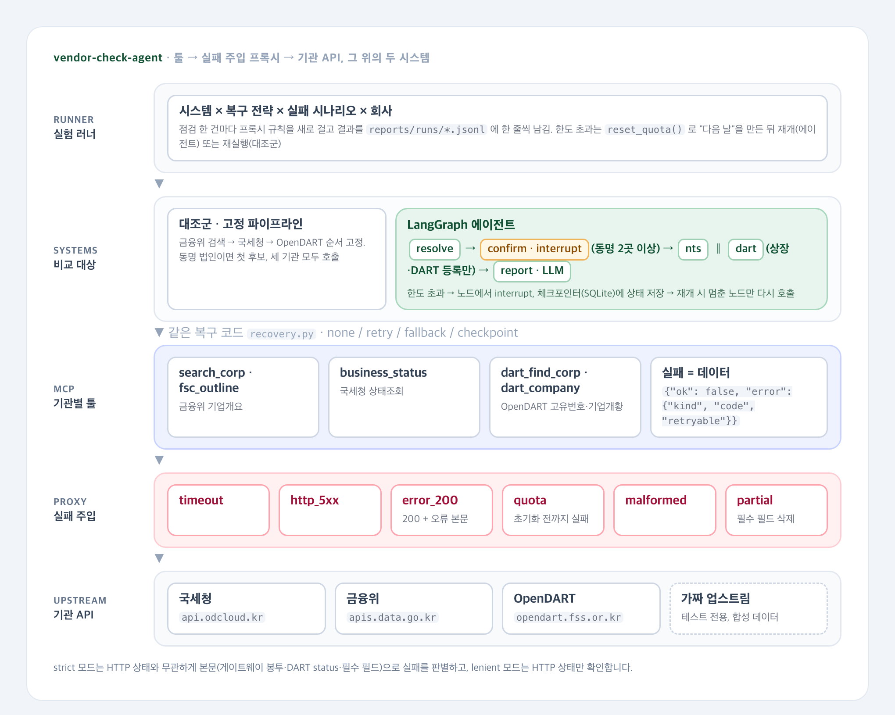

# 거래처 점검 에이전트 복구율 실험

[](https://github.com/parksungyun0411/vendor-check-agent/actions/workflows/ci.yml)  [](LICENSE)

상호를 받아 국세청·금융위원회·OpenDART 공공 API로 거래처를 점검하는 에이전트를 만들고, 공공 API에서 일어날 수 있는 실패 여섯 유형을 주입해 복구 전략별 점검 성공률(복구율)을 재는 프로젝트입니다.

공공 API의 실패는 모양이 기관마다 다릅니다. OpenDART는 오류를 HTTP 200 응답 본문의 `status` 코드로 알려 주는 것을 직접 확인했습니다. HTTP 상태만 확인하는 코드는 이 응답을 정상으로 읽고 "조회 결과 없음"을 그대로 보고할 수 있습니다. 공공데이터포털 게이트웨이는 인증 오류를 401·403과 `OpenAPI_ServiceResponse` 봉투로 돌려줬고, 한도 초과·내부 오류가 HTTP 200으로 오는지는 확인하지 못해 프록시에서 가정으로 주입합니다. 이 프로젝트는 복구율과 함께, 정상으로 보고된 값 가운데 틀린 값의 비율(조용한 오답 비율)을 따로 잽니다.

비교 대상은 고정 순서 파이프라인(대조군)과 LangGraph 에이전트입니다. 두 시스템은 같은 MCP 툴, 같은 복구 코드, 같은 항목 병합 함수를 씁니다. 다른 조건은 두 가지입니다.

- 동명 법인: 에이전트는 사람에게 확인을 요청하고(실험에서는 정답을 아는 자동 승인자가 대신 답함), 대조군은 첫 후보를 고릅니다. 그래서 대조군에 같은 확인 단계를 준 조건(`--baseline-approver truth`)과도 비교해, 그래프 구조(조건 분기, 병렬 조회, 체크포인트 재개)의 효과를 따로 봅니다.
- 보고서 LLM: 에이전트만 씁니다. 기본값(`LLM_PROVIDER=stub`)은 초안을 그대로 돌려주므로 값 지표에 영향이 없습니다. Anthropic으로 돌리면 LLM이 바꾼 값이 에이전트의 일치율·조용한 오답 비율·점검 성공률에 섞이고, 토큰·비용과 지연도 에이전트에만 생깁니다. 구조 비교는 stub으로 돌린 기록으로 합니다.

## 구현 범위

- 기관 API 클라이언트 3종: 국세청 사업자등록 상태조회(data.go.kr 15081808), 금융위원회 기업기본정보 기업개요(15043184), OpenDART 기업개황·고유번호
- 공개 명세와 직접 호출로 확인한 응답·오류 형식 정리(`docs/api_formats.md`). 확인하지 못한 항목은 코드에 `UNVERIFIED` 로 표시
- 기관별 툴 5개를 MCP 서버(MCP Python SDK 2.x `MCPServer`, stdio)로 노출. 실패는 예외가 아니라 분류된 데이터로 반환
- 툴과 기관 API 사이의 실패 주입 프록시: timeout, http_5xx, error_200(HTTP 200 + 오류 본문), quota(일일 한도 초과), malformed, partial
- 복구 전략 4종: 무대응(none), 단순 재시도(retry), 대체 경로(fallback), 체크포인트 재개(checkpoint)
- 대조군: 금융위 검색 → 국세청 → OpenDART 고정 순서 파이프라인
- LangGraph 에이전트: 동명 법인 확인(HITL interrupt), 상장·DART 등록 여부에 따른 분기, 기관별 병렬 조회(`Send`), SQLite 체크포인터로 한도 초과 후 재개
- 보고서 작성 LLM을 공급자 인터페이스 뒤에 분리. 테스트는 결정적 스텁, 실측은 Anthropic Messages API
- 정답 생성 스크립트(기관 API 직접 호출), 실험 행렬 러너, 지표 집계, 결과표 생성
- 키 없이 도는 오프라인 테스트: 합성 데이터로 응답하는 가짜 업스트림 위에서 프록시·MCP 서버·그래프를 실제로 실행

## 아키텍처



원본은 `docs/diagrams/architecture.html` 입니다.

| 층 | 파일 | 역할 |
|---|---|---|
| 실험 러너 | `src/vendor_check/eval/run.py` | 시스템 × 전략 × 시나리오 × 회사를 돌리고 점검 한 건당 한 줄을 기록 |
| 대조군 | `src/vendor_check/pipeline.py` | 고정 순서 조회. 동명 법인이면 첫 후보를 사용(`--baseline-approver truth` 면 에이전트와 같은 확인 단계) |
| 에이전트 | `src/vendor_check/graph.py` | resolve → confirm → nts ∥ dart → report |
| 복구 전략 | `src/vendor_check/recovery.py` | 두 시스템이 공유하는 호출·재시도·항목 병합 |
| MCP 서버 | `src/vendor_check/mcp_server.py`, `tools.py` | 기관별 툴 노출 |
| 실패 주입 | `src/vendor_check/proxy.py` | 기관·유형·횟수별 주입, 호출 수 집계, 한도 초기화 |
| 기관 클라이언트 | `src/vendor_check/clients/` | 요청, 정규화, 실패 분류(strict / lenient) |

에이전트 그래프의 경로는 다음과 같습니다.

| 조건 | 경로 |
|---|---|
| 금융위 검색 결과 0건 | resolve → report |
| 동명 법인 2곳 이상 | resolve → confirm(사람이 법인등록번호 선택) → 조회 |
| 상장사이거나 금감원 고유번호가 있음 | 국세청과 OpenDART를 병렬 조회 |
| 비상장이고 금감원 고유번호 없음 | 국세청만 조회, 상장 구분은 금융위 값으로 확정 |
| checkpoint 전략에서 일일 한도 초과 | 해당 노드에서 interrupt, 다음 날 그 노드만 재실행 |

## 기술 스택

| 영역 | 기술 |
|---|---|
| 언어 |  |
| 에이전트 |   |
| 툴 프로토콜 |  |
| HTTP·프록시 |    |
| LLM |  |
| 코드 품질·CI |     |

## 실행 방법

### 준비

Python 3.12와 [uv](https://docs.astral.sh/uv/)가 필요합니다. 실측에는 공공데이터포털 인증키(국세청 15081808, 금융위 15043184 활용신청)와 OpenDART 인증키가 필요하고, LLM 보고서를 실제로 쓰려면 Anthropic API 키가 필요합니다.

```bash
uv sync --extra dev --extra llm
cp .env.example .env    # 키 입력. 공공데이터포털은 Decoding 키를 넣습니다
make test lint          # 키 없이 동작합니다
```

평가 대상 회사 목록 `data/companies.csv`(열: `id,corp_name,bzno`)는 직접 만들어야 합니다. 형식은 `data/companies.example.csv` 를 참고하면 됩니다. 상장사, 비상장 법인, 휴·폐업 법인, 동명 법인을 섞어 100곳을 고를 계획입니다.

### 실험

```bash
make groundtruth        # 프록시 없이 기관 API를 직접 호출해 data/ground_truth.jsonl 생성
make baseline agent     # 실패 주입 없이 두 시스템 실행
make inject             # 실패 시나리오 34개 × 복구 전략 4종 × 두 시스템
make inject-confirm     # 같은 행렬을 동명 법인 확인을 준 대조군으로 (baseline+confirm)
make eval               # reports/runs/*.jsonl → reports/metrics.json → reports/RESULTS.md
```

금융위 개발계정 한도가 하루 10,000건(data.go.kr 15043184 상세 페이지)이라 전체 행렬은 하루에 끝나지 않습니다. `python -m vendor_check.eval.run --scenarios ... --limit N` 으로 나눠 돌리면 기록이 같은 파일에 이어 붙습니다.

### 단건 점검과 개별 구성 요소

```bash
make check NAME=상호명                          # 동명 법인이면 터미널에서 선택
python -m vendor_check.cli resume <thread_id>   # 한도 초과로 멈춘 점검을 이어서 실행
make mcp                                        # MCP 서버(stdio)
FAULT_PLAN=faults/example_plan.json make proxy  # 실패 주입 프록시 단독 실행(127.0.0.1:8787)
```

프록시를 단독으로 띄운 경우 `.env` 의 `NTS_BASE_URL`, `FSC_BASE_URL`, `DART_BASE_URL` 을 프록시 주소로 바꾸면 MCP 서버가 프록시를 거쳐 기관 API를 호출합니다.

## 평가

정답은 `make groundtruth` 가 장애 없이 기관 API를 직접 호출해 만든 `data/ground_truth.jsonl` 입니다. 한 기관이라도 조회에 실패한 회사는 정답에서 빠집니다. 실험 기록은 `reports/runs/*.jsonl`, 집계는 `reports/metrics.json`, 결과표는 `reports/RESULTS.md` 에 생성됩니다.

실험 설계(`src/vendor_check/eval/scenarios.py`, `src/vendor_check/recovery.py`):

| 항목 | 값 |
|---|---:|
| 점검 항목 | 7 |
| 실패 유형 | 6 |
| 실패 시나리오 (무주입 1 + 기관 3 × (유형 5 × 일시·지속 2 + 한도 초과 1)) | 34 |
| 복구 전략 | 4 |
| 비교 시스템 | 2 |
| 대조군의 동명 법인 선택 (첫 후보, 에이전트와 같은 확인) | 2 |

점검 항목은 상호, 대표자, 법인등록번호, 사업자등록번호, 상장 구분, 납세자 상태, 과세유형입니다.

시스템별 결과(`reports/metrics.json` 의 `overall`):

측정 전 — `make eval` 실행 후 자동 생성

| 시스템 | 점검 항목 일치율 | 조용한 오답 비율 | 한도 초과 재개 성공률 |
|---|---:|---:|---:|
| 고정 파이프라인 (첫 후보) |  |  |  |
| 고정 파이프라인 + 같은 확인 단계 (`baseline+confirm`) |  |  |  |
| LangGraph 에이전트 |  |  |  |

두 가지 비교로 나눠 읽습니다.

- 에이전트 대 첫 후보 대조군: 동명 법인 확인과 그래프 구조를 합친 차이
- 에이전트 대 같은 확인 단계를 준 대조군: 그래프 구조만의 차이(보고서 LLM은 stub)

실패 유형 × 복구 전략 점검 성공률(`reports/RESULTS.md`):

측정 전 — `make eval` 실행 후 자동 생성

| 실패 유형 | none | retry | fallback | checkpoint |
|---|---:|---:|---:|---:|
| timeout |  |  |  |  |
| http_5xx |  |  |  |  |
| error_200 |  |  |  |  |
| quota |  |  |  |  |
| malformed |  |  |  |  |
| partial |  |  |  |  |

### 응답 시간과 비용

측정 전 — `make eval` 실행 후 자동 생성

| 시스템 | 건당 토큰(입력/출력) | 건당 비용 | p95 지연(초) |
|---|---:|---:|---:|
| 고정 파이프라인 |  |  |  |
| LangGraph 에이전트 |  |  |  |

비용은 `.env` 의 `LLM_PRICE_INPUT_PER_MTOK`, `LLM_PRICE_OUTPUT_PER_MTOK` 를 채웠을 때만 계산됩니다. 대조군은 LLM을 쓰지 않으므로 토큰·비용 칸은 에이전트에만 채워집니다.

지표 정의(`src/vendor_check/eval/metrics.py`):

- 점검 항목 일치율: (점검, 항목) 쌍 가운데 정상으로 보고했고 값이 정답과 같은 비율
- 점검 성공률: 7개 항목이 모두 정답과 같은 점검의 비율
- 조용한 오답 비율: 정상으로 보고된 값 가운데 틀린 값의 비율. 툴 실패 여부와 관계없이 세므로, 동명 법인을 잘못 고른 값과 대체 경로의 기관 간 표기 차이도 여기에 들어갑니다
- 재개 성공률: 한도 초과로 멈춘 점검 가운데 재개 후 점검에 성공한 비율

오프라인 테스트가 합성 데이터에서 확인하는 값은 동작을 검증하는 단언이며, 위 표에 넣지 않습니다.

## 프로젝트 구조

```text
vendor-check-agent/
├── src/vendor_check/
│   ├── clients/         국세청·금융위·OpenDART 클라이언트, 게이트웨이 오류 판별
│   ├── tools.py         기관별 툴 (실패를 데이터로 반환)
│   ├── mcp_server.py    MCP 서버
│   ├── gateway.py       MCP 클라이언트 통로
│   ├── proxy.py         실패 주입 프록시
│   ├── recovery.py      복구 전략, 점검 항목 병합
│   ├── pipeline.py      대조군 파이프라인
│   ├── graph.py         LangGraph 에이전트
│   ├── llm.py           보고서 작성 LLM 인터페이스
│   ├── cli.py           단건 대화형 점검
│   ├── fake_upstream.py 테스트용 가짜 기관 API
│   └── eval/            정답 생성, 시나리오, 러너, 지표, 결과표
├── tests/               오프라인 테스트, fixtures/ 는 합성 데이터
├── docs/                API 응답·오류 형식 정리, 아키텍처 다이어그램
├── data/                평가 대상 목록 예시 (실제 목록과 정답은 커밋하지 않음)
├── faults/              프록시 단독 실행용 실패 계획 예시
└── reports/             결과표 (실험 기록과 집계는 커밋하지 않음)
```

## 구현하면서 신경 쓴 점

- 툴은 실패해도 예외를 던지지 않고 `{"ok": false, "error": {"kind", "code", "retryable"}}` 를 돌려줍니다. MCP 경계를 지나도 실패 종류가 남아야 두 시스템이 같은 기준으로 복구 여부를 판단할 수 있기 때문입니다.
- 오류 판별은 HTTP 상태가 아니라 응답 본문을 기준으로 했습니다. 2026-10-03에 임의 키로 직접 호출했을 때 OpenDART는 HTTP 200에 `status: "010"` 을, 공공데이터포털은 401·403에 `OpenAPI_ServiceResponse` 봉투를 돌려줬습니다. 한도 초과 때의 상태 코드는 확인하지 못했으므로 상태 코드에 기대지 않도록 했습니다. HTTP 상태만 보는 lenient 모드를 설정(`DETECTION_MODE`)으로 남겨, 오류 본문이 "미등록" 같은 정상 값으로 바뀌는 경로를 테스트로 고정했습니다. 실험 행렬에는 이 축이 없어 비교하려면 따로 실행합니다.
- 복구 전략은 하나씩 따로 적용합니다. 재시도는 일시적인 실패에만 하고 일일 한도·인증 오류는 재시도하지 않습니다. 대체 경로는 금융위가 실패했을 때 OpenDART 고유번호 목록에서 법인을 찾고, 거기서 얻은 사업자번호로 국세청 조회까지 이어 갑니다.
- 체크포인트 재개는 기관 노드 단위로 동작합니다. 국세청과 OpenDART를 같은 단계에서 병렬로 조회하므로, 한쪽이 한도 초과로 멈춰도 끝난 쪽의 결과는 체크포인트에 남습니다. 재개 전후 프록시의 업스트림 호출 수로 끝난 기관을 다시 부르지 않는 것을 테스트합니다. 대조군은 같은 상황에서 처음부터 다시 실행합니다.
- 경로 결정은 규칙으로 하고, LLM은 병합된 초안과 실패 기록을 받아 최종 보고서만 씁니다. LLM이 값을 바꾸거나 실패 항목을 채우면 그 결과가 조용한 오답 비율에 그대로 반영됩니다.
- 실제 API 키와 LLM이 필요한 경로는 기본 테스트와 분리했습니다. CI는 합성 데이터의 가짜 업스트림만 사용합니다.

## 한계

- 아직 측정 결과가 없습니다. 위 표는 키를 발급받아 정답 생성과 실험을 돌린 뒤에 채워집니다.
- 정답은 장애 없이 같은 API를 호출한 값입니다. 기관 원본 자체의 오류나 기관 간 표기 차이(대표자 이름 등)는 정답에 그대로 들어가며, 대체 경로가 다른 기관 값을 쓰면 불일치로 집계됩니다.
- 공공데이터포털이 한도 초과·내부 오류를 HTTP 200으로 돌려주는지는 재현하지 못했습니다. 프록시의 error_200·quota는 이 형식을 가정한 것입니다. 금융위 JSON 응답 구조, 상장 구분 코드 값, 금감원 고유번호와 OpenDART 고유번호의 관계, 국세청의 미등록·한도 초과 응답도 확인하지 못했습니다(`docs/api_formats.md`).
- 실험에서 동명 법인 선택은 정답을 아는 자동 승인자가 합니다. 사람이 고를 때 생기는 오류는 측정하지 않습니다. 이 승인자 때문에 동명 법인 회사에서는 에이전트가 첫 후보를 쓰는 대조군보다 구조적으로 유리하므로, 같은 승인자를 준 대조군 조건을 함께 돌립니다.
- OpenDART 고유번호 목록(corpCode.xml)은 한 번 받은 뒤 파일·메모리 캐시를 씁니다. 그래서 DART 실패 주입은 사실상 기업개황 호출에만 걸리고, 고유번호 목록 조회가 실패하는 경로는 측정하지 않습니다.
- 실패는 점검마다 한 기관에 하나씩만 겁니다. 여러 기관이 동시에 실패하거나 장애가 여러 점검에 걸쳐 이어지는 상황은 다루지 않습니다.
- 복구 전략을 조합했을 때의 효과는 측정하지 않습니다.
- 조달청 나라장터, 공정위 소속회사 조회, Langfuse 트레이싱은 구현하지 않았습니다.

## 라이선스

MIT
